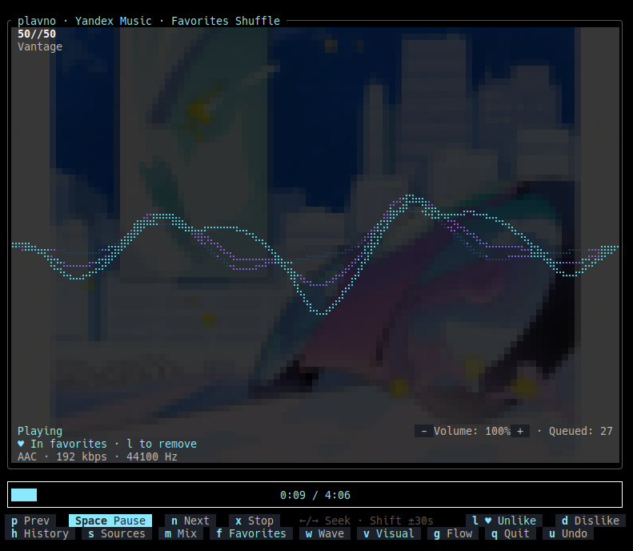

<div align="center">

# plavno

A lightweight music TUI for Linux with service waves, library shuffle, and mouse controls.



[](LICENSE)

[Quick start](#quick-start) · [Services](#services) · [Controls](#controls)

</div>

## Quick start

Requires Rust, pkg-config, ALSA and D-Bus headers: `libasound2-dev libdbus-1-dev`
(Debian/Ubuntu) or `alsa-lib-devel dbus-devel` (Fedora). Audio uses the ALSA default
device; PipeWire/PulseAudio needs its ALSA plugin. Install ffmpeg for HLS playback.

```sh
cargo build --release
export PATH="$PWD/target/release:$PATH"
plavno sources
```

Connect a service below, then start it with `plavno --source SOURCE`.
For development, use `cargo run` or `cargo check` and keep the build cache.

## Services

| Service | Source key | Stable | Playback | Connection |
|---|---|:---:|---|---|
| Yandex Music | `yandex` | 🟢 | My Vibe, favorites shuffle, flow presets | OAuth token; full tracks require account access / Yandex Plus |
| VK Music | `vk` | 🟢 | Recommendations, My Music shuffle, flow presets | Installed Chrome/Chromium or manual session import |
| SoundCloud | `soundcloud` | — | Track stations | Browser sign-in or a public seed track |
| Spotify | `spotify` | — | Track radio | Optional Rust helper; Premium and OAuth |
| YouTube Music | `ytmusic` | — | Home mixes and track radio | Optional Rust helper; cookies or a public seed |

### Yandex Music

Get an OAuth token from the [token guide](https://ym.marshal.dev/token), paste it
into `plavno login yandex`, then run `plavno --source yandex`.

### VK Music

Run `plavno login vk` and sign in through installed Chrome/Chromium, then run
`plavno --source vk`. Alternatively, [import a session manually](docs/services.md#manual-vk-session)
with `plavno login vk --manual`.

### SoundCloud

Run `plavno login soundcloud`, sign in through Chrome/Chromium, and choose a
seed track when prompted. Start with `plavno --source soundcloud`.
[Manual setup](docs/services.md#manual-soundcloud-session) also supports public track stations.

### Spotify

[Build the Spotify helper](docs/services.md#spotify-and-youtube-music), then run
`plavno login spotify` and paste a JSON profile with a seed track URI, OAuth token
with `streaming` scope, and client ID. Premium is required. Start with `plavno --source spotify`.

### YouTube Music

[Build the YouTube helper](docs/services.md#spotify-and-youtube-music), then run
`plavno login ytmusic` and paste `{"cookies":"/absolute/path/youtube-cookies.txt"}`
using a Netscape cookie export, or `{"seed":"VIDEO_ID_OR_URL"}` for public radio.
Start with `plavno --source ytmusic`.

See [service setup](docs/services.md) for profile examples and troubleshooting.

## Run

```sh
plavno sources                         # List supported services and connection status
plavno --source yandex                  # Yandex Music My Vibe
plavno --source yandex --favorites      # Shuffle Yandex favorites
plavno --source vk                      # VK recommendations
plavno --source vk --favorites          # Shuffle VK My Music
plavno --source mixed                   # Mix waves from connected services
plavno --file /path/to/track.flac        # Play a local file
plavno --no-wave                        # Start without visualization
```

## Controls

Buttons display their hotkeys and support mouse clicks.

| Key | Action |
|---|---|
| Space / x | Pause or resume / stop |
| p / n | Previous / next track |
| ← / → | Seek 5 seconds; Shift or Ctrl: 30 seconds |
| Home / End | Start / end of track |
| + / - | Volume; also click beside the percentage |
| l | Like / unlike in Yandex favorites or VK My Music |
| d / u | Dislike and skip / undo dislike |
| h or / | History: type to search, ↑/↓ select, Enter play |
| s / m | Choose a service / mix service waves |
| w / f | New wave / library shuffle (VK: My Music) |
| g | Flow: Calm, Balanced, Energetic, Work; choose with 1–4 or a click |
| v | Toggle visualization |
| Ctrl+C | Copy selected text; quit when nothing is selected |
| Esc / q | Clear selection or close a view / quit |

Click or drag the progress bar to seek. Scroll over it to seek; elsewhere scroll
changes volume. Drag over the title or artist and press Ctrl+C to copy (requires
terminal OSC 52 support). In History and Sources, click to select, double-click
to play, scroll to navigate, and right-click to close.

Flow changes recommendations. Work requests calm ambient without vocals on Yandex
and calm instrumental tracks on VK. `w` returns from library shuffle to a new wave;
VK filters recent tracks to avoid repeating the initial queue.

## Playback and data

Playback starts while downloading, at the highest available supported quality.
Previous, current, and next audio files stay in RAM for seeking and replay;
RAM use depends on track size. Service audio is not saved to disk.

Configuration lives in `~/.config/plavno`; history and permanent dislikes live in
`~/.local/state/plavno`. `XDG_CONFIG_HOME` and `XDG_STATE_HOME` override these roots.
History stores metadata for the last 2000 plays. Yandex and VK also receive account
dislikes; `u` undoes them. Volume starts at 100%.

Media keys and `playerctl` work through session D-Bus, for example:
`playerctl -p plavno play-pause` or `playerctl -p plavno position 5+`.

## Checks

```sh
cargo fmt --check
cargo test
cargo clippy --all-targets -- -D warnings
```

Release steps: [Publishing to crates.io](docs/publishing.md).

## License

[Apache License 2.0](LICENSE).
