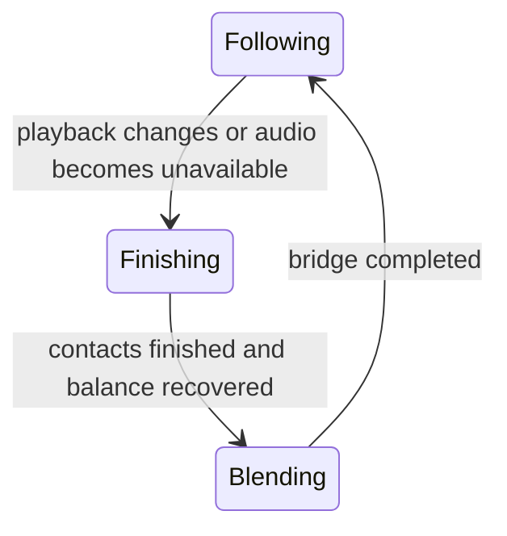

# Dance prototype

Braille is the default renderer for the silhouette and wave. The wave remains
visible in Dance mode. `--dance-style auto|flow|groove|pulse|house|hiphop|rave` selects a movement
character; `auto` is the default. The named styles are procedural interpretations.

For native pixels in a sixel-capable terminal such as foot:

```sh
plavno --dance-style flow --renderer sixel
```

The sixel path shares the spatial rig and surface renderer, with independent
pixel colors instead of one foreground color per Braille cell. It uses the
terminal's reported cell pixel dimensions and crops to the figure and its trail.
The wave and controls remain terminal text, and text takes priority over graphics.
Sixel uses the detailed skin by default: a violet jacket, dark trousers, cyan
sneakers and headphones, brown hair, and a ponytail. Its 28-color palette adds
surface shading, eyes, cuffs, shoe soles, and clothing seams to the same 3D rig.
Clothing and accessories turn with the body and share its depth buffer.
Compare the previous appearance with `--dance-skin silhouette`; use
`--dance-skin detailed` to select the skin explicitly. Braille keeps its silhouette.
The original [pose sheet](images/dancer-poses.webp) is preserved as a visual reference.

Transparent sixels preserve the artwork. `--sixel-update diff` (default) compares
pixels, palette colors, and underlying text, then restores text and redraws sixel
only inside the bounding rectangle of changed cells. Identical frames send no
graphics. Use `--sixel-update full` to clear and repaint the screen each frame.
Transparency blends with existing images; it cannot erase old pixels by itself.
The diff mode therefore requires terminals such as foot that erase sixel pixels
when text overwrites their cells. Both modes synchronize text and graphics and
handle menus, resize, and visualization toggles. Startup and resize use a full
repaint. `auto` continues to select Braille. Run directly in foot if a multiplexer
omits pixel dimensions.
The small fixed-palette encoder builds all color planes in one pass per six-row
band and uses run-length compression. Contour masks use squared distances without per-pixel square roots.
These paths retain the same frame rate and pixel resolution; no external image
converter or runtime dependency is required.

The TUI caches the background and static text/control cells between events.
Animation and progress are composited each frame; the clock label changes once
per second. Track, artwork, playback state, input, and size changes rebuild the
static layers while preserving text selection and mouse hit areas.
Switching Wave/Dance or hiding the visualization retains its animation state.

Auto mixes repertoires rather than assigning every track one dance:

| Repertoire | Movement bias |
| --- | --- |
| House | Torso jacking, shuffle lifts, weight transfer |
| Hip-hop | Beat-driven rocks, bounce, alternating arm strikes |
| Rave | Compact hakken-inspired steps, heel-toe accents, stomps and arm pumps |
| Flow | Sustained gestures, spatial travel, restrained footwork |

Onset tempo, regularity, energy, and bass set the mixture. Available genre labels
provide a soft prior; they cannot force energetic footwork without audible drive.
Ambient labels favor Flow even when the onset estimate is fast. Yandex album genres
and SoundCloud track genres come from existing metadata responses, with no additional
API requests. The labels survive local history serialization; old records without
them remain readable. Other sources use audio features unless metadata includes a
genre. Broad or missing labels fall back to the same audio-driven selection.

Mixture weights blend over three seconds. The weighted choice of a new motif waits
for a phrase boundary and planted contacts, so changing genre does not replace an
unfinished step. Existing track-transition and body constraints still apply.
The frontal hakken interpretation uses alternating lifts and small heel-toe accents;
it does not reproduce the tutorial's full backward slide or authored kicks.

The prototype separates audio features, choreography, the body rig, and drawing:

- `dancer.rs` follows energy, bass, transients, onset intervals, and their
  regularity. It retains a short spatial pose history for the trail.
- `choreography.rs` assembles variable phrases with a fresh seed for each dancer
  session. Track changes retain this sequence and the body rig. It avoids the two
  most recent moves and varies reach, hand timing, and phrasing.
  Travel phrases take several steps and turn back near the stage edge. Crouches
  and hops are reserved for energetic rhythmic profiles; hops include preparation,
  flight, and a cushioned landing.
  Rhythmic phrases also mix torso jacking, shuffle-inspired alternating knee lifts
  with counterposed arm pumps, and stomps with a held lift and sharper landing.
  Stage travel keeps longer phrases so the shorter club motifs leave room to walk.
  Its duration also allows enough contacts to cover the distance; high tempos do
  not compress a long walk into an impossibly short phrase.
- `dance_motion.rs` blends movement profiles over several seconds. Flow uses an
  independent, sustained phrase clock. Footwork is selected once per contact cycle:
  planted weight shifts, unloaded floor drags, low skimming steps, or explicit lifts.
  Jacks and rocks favor planted contacts; travel mixes drags and low steps, while
  shuffle, stomp, and hakken motifs retain their deliberate lifts.
  Pulse uses quicker contacts, shorter phrases, and firmer accents.
  Contacts have a minimum cycle time. At very high tempos, strides and lifts shrink
  rather than replaying the same poses faster.
  Strong moderate-tempo music can also reach Pulse; tempo alone does not decide it.
- Detected onsets inject velocity into the body bounce and torso lean. Each onset
  samples movement strength and direction once; there is no per-frame random jitter.
  `dance_balance.rs` models torso momentum, a corrective step, a supported fall,
  and standing back up. Rare overcommitted impulses require energetic, regular
  beats; improvised falls have a 40-second cooldown. The projected centre of mass
  and horizontal momentum are also checked against the available and planned
  support. Sustained overshoot requests a corrective step; a severe loss of
  support can cause a fall even during the cooldown.
  This is a small balance model, not a ragdoll.
- Loaded feet stay at fixed stage coordinates. Deliberate drags unload the moving
  foot before its smooth floor trajectory and settle it before weight returns.
  Low steps clear the floor by at most about four centimetres; a lifted foot follows
  a separate lift and landing curve. Resting legs approach full extension; steps, accents,
  crouches, and landings introduce knee flexion.
  Weight transfer drives the pelvis with bounded ground
  force, carrying the entire body. The torso and head use relative joint angles
  with elastic inertia and a lean into acceleration or braking; they cannot remain
  at an old stage position and stretch the spine.
  Jump height determines ballistic flight time under scaled gravity. Preparation
  and landing can follow tempo, while airborne horizontal momentum is preserved.
  Takeoff waits for a settled stance and room to land inside the stage.
- `dance_motion.rs` retains the gesture clocks, bounded shoulder/elbow controller,
  contact planning, and balance dynamics. Flow's gesture paths and independent
  timing remain the basis of the movement.
- `dance_space.rs` builds a connected spatial skeleton from those targets. Pelvis,
  torso, and head have separate damped yaw; upper-body pitch adds depth to lean.
  Travel biases facing toward movement. Weight transfer adds a pelvic twist;
  shoulders counter that transfer and follow asymmetric arm reaches, with bounded
  relative targets and damped turns. Wrists move in local body coordinates
  with a damped depth drive, and arms and legs solve pole-controlled 3D IK.
  Bone lengths stay fixed in world space while projected lengths can shrink.
  Contact checks include the thickness of the exposed upper arm and forearm,
  rather than only the elbow joint. Collision and rendering share the same trunk,
  pelvis, and leg volumes; the shoulder socket remains attached inside the torso. Contact redirects each bone
  on its fixed-length sphere, so the hand can continue moving around a blocked
  elbow without stretching the forearm or freezing the whole arm. Contact normals
  blend across overlapping body volumes, and pushout uses the same clearance as
  the acceptance check, preventing chatter while hands slide past the hips.
  The knee poles face forward in the pelvis frame. A planted ankle retains its
  world position during turns; depth changes happen during a swing or deliberate
  floor drag. Pelvis height
  respects both spatial leg reaches. Orthographic projection keeps the stage
  stable and gives the existing Braille renderer screen coordinates.
  Playback changes preserve these springs and the skeleton; pause freezes them.
  This is a spatial procedural rig with the existing ground-motion planner,
  not a full anatomical simulation or a collision ragdoll.
- A cool rim lights the upper and left edges inside the silhouette without adding
  thickness. Tiny face cutouts and soft highlights follow the head and disappear
  at small scales. Each Braille cell shares one foreground color: rim and detail
  coverage tint it gently. Movement trails stay dim and cannot add dots to cells
  occupied by the current figure.
  Arms use a separate lavender tint, weighted by their coverage when they share a
  cell with the torso. Small rounded palms extend along the forearm direction;
  a thumb appears at larger scales. Tiny figures omit these extra hand details.
  A small CPU surface buffer resolves the nearest tapered limb/body volume
  and head surface at each dot. Real joint depth determines occlusion, including
  hands aimed at the viewer; drawing order cannot bring rear arms forward.
  Visible rear portions use dimmer lavender. Ordered tint coverage blends the
  shading, while shared Braille cells preserve the visible body's color.
  Face points and a small nose turn with the head and respect the surface buffer.
  The renderer needs no GPU or additional runtime dependencies.

Onset-based tempo and automatic profile selection are approximate. Loud sustained
music can still use Flow; a fast onset rate alone does not justify jumping.
There is no genre classifier, motion-capture dataset, or learned model in the
runtime. This is a constrained procedural improvisation, built from reusable
movement primitives. It varies their combinations rather than guaranteeing that
every pose is unique.

## Track transitions and animation state

A new playback resets onset confidence and measurement timing while retaining the
pose, stage position, pose history, gesture phase, RNG, and spring velocities.
A small transition state machine handles the change:



Finishing prohibits new steps and jumps while allowing the existing contact cycle
and any necessary balance recovery to complete. Corrective steps can finish even
during a track transition. Blending uses a short grounded phrase while the style weights and
cadence move toward the incoming audio. Joint targets keep their spring inertia;
IK then preserves limb lengths. This applies the principle of inertial animation
transitions to the procedural rig, rather than implementing an Unreal blend node.

A loading gap continues the transition and settles into a held pose. The TUI keeps
animation frames active until it settles; explicit pause freezes the animation.
Rapid track skips update the input without restarting an ongoing bridge.

## Research basis

- [Foot control sequences](https://codeberg.org/dnkl/foot/src/branch/master/doc/foot-ctlseqs.7.scd)
  and [sixel implementation](https://codeberg.org/dnkl/foot/src/branch/master/sixel.c):
  transparent images, square-pixel raster attributes, and synchronized updates
  inform the terminal graphics integration.
- [STEEZY: Running Man tutorial](https://www.steezy.co/posts/how-to-do-the-running-man)
  and its [demonstration](https://www.youtube.com/watch?v=MExsCVLBH-g): alternating
  knee lifts, downward bounce, and arm pumping inform the shuffle motif. The
  procedural front-view interpretation preserves planted contacts instead of
  recreating the full backward-slide step.
- [The Slendy Show: Hakken tutorial](https://www.youtube.com/watch?v=sPcu9cWb6V8):
  alternating back-steps, short kicks, and counterposed arm work inform the rave
  repertoire. The movement primitives are original, not extracted motion capture.
- [STEEZY: Hip Hop Dance](https://www.steezy.co/posts/what-is-hip-hop-dance):
  bounce and rocks inform the slower, grounded repertoire.
- [STEEZY: House Dance](https://www.steezy.co/posts/what-is-house-dance):
  jacking, footwork, and improvisation inform torso accents and varied phrases.
- [Laban/Bartenieff Movement System, EMOVE](https://www.emoveinstitute.com/home-lbms/general-information-lbms/):
  body organization, succession, dynamics, phrasing, and spatial paths explain
  why simultaneous joint oscillations are insufficient for expressive movement.
- [ChoreoMaster, SIGGRAPH 2021](https://netease-gameai.github.io/ChoreoMaster/):
  dance synthesis treats style, rhythm, and phrase structure as related but
  distinct constraints. Its paper includes hand trajectories and foot contacts
  in motion rhythm features.
- [EDGE, CVPR 2023](https://arxiv.org/html/2211.10658v2):
  foot-contact consistency addresses sliding feet and improves motion realism.
- [AIST++](https://google.github.io/aistplusplus_dataset/factsfigures.html):
  real motion sequences include joint rotations and root trajectories across
  multiple dance genres; this is a future reference for richer choreography.

- [Epic: animation state machines](https://dev.epicgames.com/documentation/en-us/unreal-engine/state-machines-in-unreal-engine):
  states and transition rules define which actions may follow each other.
- [Epic: inertial blending](https://dev.epicgames.com/documentation/en-us/unreal-engine/animation-blueprint-blend-nodes-in-unreal-engine):
  incoming motion can retain continuity from the outgoing animation; transition
  smoothing precedes final IK corrections.
- [Epic: Motion Matching](https://dev.epicgames.com/documentation/en-us/unreal-engine/motion-matching-in-unreal-engine):
  pose, velocity, and trajectory queries select motion from an animation database.
  A database of captured or authored dance clips would be a separate future step.
- [Ubisoft: creating choreography for Just Dance](https://news.ubisoft.com/en-us/article/2gy5XLQ4JikkZRiY14Z5hN/how-just-dance-2025-edition-raises-adhd-awareness):
  dance content is authored for individual songs. A behavior state machine helps
  sequence movement; expressive movement content still needs choreography.

The procedural profiles are original approximations informed by these principles;
they do not reproduce these systems or claim their demonstrated quality.
